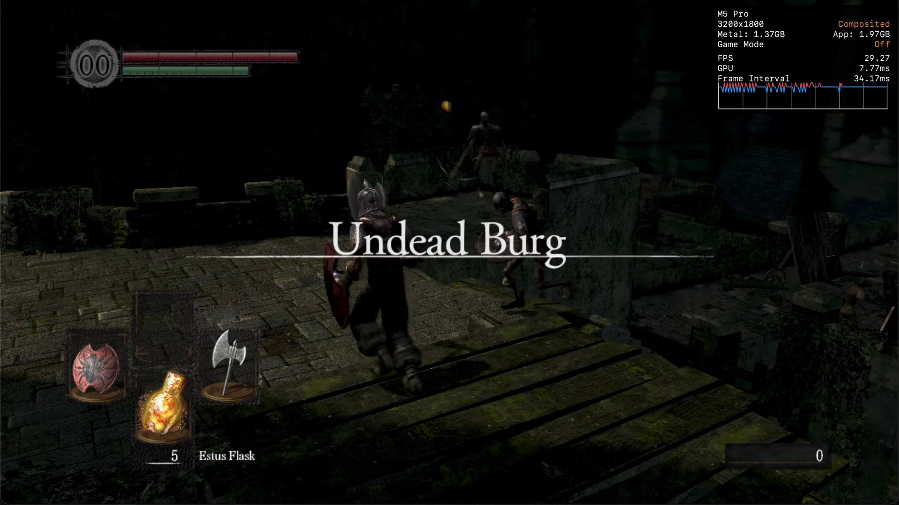

# darksouls-mac

**Dark Souls: Prepare to Die Edition, running natively on Apple silicon Macs.**

No emulator, no Wine, no virtual machine. The game's original 32-bit Windows
code is statically recompiled into native ARM64 code, and the Windows APIs it
calls (Direct3D 9, DirectInput, XInput, the C runtime, Games for Windows LIVE,
DirectSound, ...) are reimplemented on top of macOS, Metal and SDL3.



This repository contains **no game files**. You need your own copy of the
game; the build reads it from your disk and generates everything else.

### Which version of the game works

Only **1.0.2.0**, the last Games for Windows LIVE build, whose executable
is `DATA/DATA.exe` (the setup checks its SHA-256 and stops if it differs).
That is the version disc copies update to and the one Steam shipped before
GFWL was removed.

The version Steam serves today has GFWL removed and is a different
executable; it **does not work yet**. Support for it is tracked in
[#11](https://github.com/aplaino/darksouls-mac/issues/11).

## Status

Playable from start through the first areas:

- 30 fps, steady (the game's own cap), on an M-series Mac
- Metal renderer with higher-than-original quality: the 3D scene at 3072x2160
  instead of the PC version's fixed 1024x720, 4096x4096 shadow maps, SMAA and
  16x anisotropic filtering
- Sound and music (FMOD through DirectSound)
- Xbox / PlayStation / Switch controllers, or keyboard and mouse (menus
  included: arrows, Enter, Backspace)
- Saving and loading

Known issues:

- On-screen button prompts show Xbox buttons even with keyboard and mouse.
  The original PC release does the same; the keyboard defaults are W A S D
  move, I J K L camera, O lock on, H/U right hand, Tab left hand, Q
  interact, Space roll, E use item, F/R/C/V switch item/spell/weapons, G
  gestures, Escape menu, and Enter/Backspace/arrows in menus.
- Water reflections that use clip planes are not drawn correctly yet.
- Shadows have hard edges (no hardware PCF filtering yet).

See [PLAN.md](PLAN.md) for engineering notes and what's next.

## Performance compared with CrossOver

The same game files and the same save run natively here and under
CrossOver 26.3 (Wine, with Rosetta 2 translating the x86 code). Standing
still where the save starts, in the Undead Burg, for 60 s, three runs each, on an
M5 Pro (macOS 26.6), plugged in:

| | Frame rate | CPU | Memory |
|---|---|---|---|
| This port, original settings | 30 (the game's cap), every second | 1.1 cores | 1.3 GB |
| This port, default settings (3x scene, SMAA, 16x AF) | 30, every second | 1.1 cores | 1.4 GB |
| CrossOver, wined3d (its default for D3D9), msync on | 13.1 average | 2.5 cores | 1.0 GB |
| CrossOver, DXVK | black screen | | |

The port's GPU needs 2.5 ms of each 33 ms frame at the original settings
and 7.7 ms at the defaults. The comparison is as equal as we could make it:
same window size (the port draws it at Retina resolution, CrossOver at 1x),
the game's own anti-aliasing off on both, and GFWL answered the same way on
both. CrossOver has no GFWL, so it gets [bench/xlive](bench/xlive), the
runtime's offline answers built as a Windows DLL. The camera is not fully
controlled after loading; a CrossOver run where it faced a wall reached
30 fps and is left out. One scene only: busier ones may differ either way.

To run it yourself: `bench/cx_setup.sh` (needs CrossOver and
`brew install mingw-w64`) sets up the bottle, `bench/run_all.sh` runs every
configuration three times (it takes over the screen for about 30 minutes)
and `bench/summarize.py /tmp/ds1bench/results` prints the table. If your
install starts the game through another executable, put
`CX_EXE=<name>` in `bench/local.env`.

## How it works

1. **Analysis.** Ghidra analyses the game's `DATA.exe` (version 1.0.2.0) and
   its two FMOD DLLs. The function list and jump tables are exported to
   `symbols/`.
2. **Lifting.** [x86recomp](https://github.com/aplaino/x86recomp)'s lifter
   translates every function into C++ that operates on a model of the x86 CPU
   (registers, flags, an exact x87 FPU, SSE). `manifest/` holds the per-game
   knowledge the analysis can't find on its own, such as functions reached
   only through `setjmp`/`longjmp`. The output (about 116,000 functions,
   8.4 million instructions) goes to `generated/` and is compiled with clang.
3. **Runtime.** x86recomp's runtime loads the original executable image into
   a 32-bit guest address space and runs the compiled code. Every Windows
   function the game imports is implemented natively ("HLE"): Direct3D 9 calls
   become Metal draws, DirectInput reads SDL's keyboard and mouse, XInput
   reads game controllers, GFWL is answered offline, and so on. Code that was
   never found during lifting is a fatal error naming its address, never
   emulated, so every gap gets fixed in the lifter rather than hidden.
4. **This repo** adds what is specific to Dark Souls: `src/main.cpp`
   (the game's configuration: thread priorities, input, renderer), the
   manifests, the build and launch scripts, and the app bundle.

The x86recomp changes made for this port (a game whose window lives on a
worker thread, depth-stencil textures as hardware shadow maps, occlusion
queries, `setjmp`/`longjmp`, and more) are generic and live in the library,
on the `darksouls` branch of the submodule.

## Building

You need:

- a Mac with Apple silicon, the Xcode command line tools
  (`xcode-select --install`) and [Homebrew](https://brew.sh)
- your own copy of Dark Souls: Prepare to Die Edition updated to
  **1.0.2.0**, the GFWL build (see
  [Which version of the game works](#which-version-of-the-game-works))
- about 8 GB of free space and time: the first build compiles about
  1.5 GB of generated C++, which takes hours on a laptop

```sh
git clone --recursive https://github.com/aplaino/darksouls-mac
cd darksouls-mac
tools/setup.sh "/path/to/your/game"     # the folder with DATA/ inside
```

`setup.sh` installs the Homebrew packages, builds the lifter, translates
your `DATA.exe`, compiles the game and installs **Dark Souls** in
`/Applications`. Start it from there, from Spotlight or from the Dock. Logs go to
`~/Library/Logs/DarkSouls`.

The steps one by one, if you want them:

```sh
brew install cmake ninja llvm@22 sdl3 ffmpeg glslang spirv-cross pkgconf upx python
echo 'DARKSOULS_GAME_DIR="/path/to/your/game"' > tools/local.env
cmake --preset release
cmake --build out/build/release --target recomp_lift   # the lifter
tools/lift.sh                  # translates your DATA.exe into generated/
tools/build.sh                 # compiles the game
tools/app.sh --install         # the app, copied to /Applications
```

`tools/build.sh` takes a lock so two builds never share the build directory.
After a runtime change it rebuilds in seconds; only a re-lift recompiles game
code, and then only the files that changed. Run `tools/app.sh --install`
again after each build. Ghidra is needed only to redo the analysis; its
results are in `symbols/`.

Graphics options (set in `tools/app.sh`; each can be overridden with
`open --env NAME=value -a "Dark Souls"`):

| Variable | Default | Effect |
|---|---|---|
| `RECOMP_RT_BOOST` | `1024x720:3,512x360:3,256x180:3,2048x2048:2` | render targets drawn larger (scene 3x, shadow map 2x) |
| `RECOMP_UPSCALER` | `smaa` | anti-aliasing of the finished frame |
| `DARKSOULS_ANISO` | `16` | anisotropic filtering |
| `MTL_HUD_ENABLED` | `1` | macOS Metal performance overlay (fps, frame time) |

Developer switches (environment): `DARKSOULS_TRACE=1` (every Windows call),
`DARKSOULS_FPS_REPORT=1`, `DARKSOULS_KEY_LOG=1`, `DARKSOULS_INPUT_RECORD=file`
and `DARKSOULS_TEST_INPUT=file` (record and replay input),
`DARKSOULS_SHOT_DIR=dir DARKSOULS_SHOT_EVERY=n` (save frames),
`DARKSOULS_HIDDEN=1` (no window).

## Credits

- [x86recomp](https://github.com/Awis13/x86recomp) (MIT), the recompiler and
  runtime this is built on, and Liberty Pro Max, its GTA IV port, which this
  project's structure follows.
- DSFix by Durante, for documenting what the PC version's rendering needed.

Dark Souls is a trademark of FromSoftware and Bandai Namco. This project is
not affiliated with them and includes none of their files.
